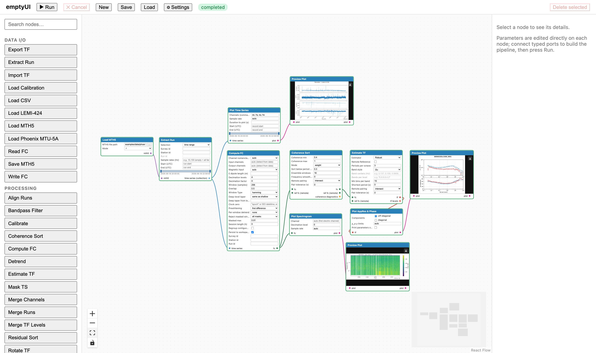

# emptyUI

A node-based, visual workflow interface for magnetotelluric (MT) data
processing and TF estimation — a ComfyUI-style canvas where processing
chains are built by connecting typed ports, with publication-quality
plots, verified end-to-end on real data.



*The demo workflow (below) — Load MTH5 → Extract Run → Compute FC →
Coherence Sort → Estimate TF, with the time series, apparent
resistivity/phase and spectrogram plots rendered on the canvas.*

## Quick start

Requires **Python ≥ 3.10** (3.12 recommended) and **Node ≥ 20** (needed
once to build the web frontend; serving afterwards is pure Python).
[uv](https://docs.astral.sh/uv/) is optional but speeds the install up.

```bash
./scripts/install.sh          # .venv + editable packages + npm install
./scripts/serve.sh            # frontend + API on http://127.0.0.1:8000
```

Then open **http://127.0.0.1:8000** in any modern browser and:

1. Click **Load** and pick `examples/workflow/phoenix-mtu5a-smoke.emptyui.json`.
2. Click **▶ Run** — the chain completes in well under a minute.
3. Click the **Preview Plot** nodes to see the time series, the apparent
   resistivity/phase curve and the spectrogram.

That workflow is the tracked-data demo: it reads the bundled Phoenix
MTU-5A archive (`examples/data/phoenix-mtu-test/smoke_phoenix_mtu.mth5`,
a 3-hour real instrument recording, logger MTU-1690), so it works with
no data of your own. The Python-only variant — for servers without
Node — is `./scripts/install.sh --backend-only`, then
`./scripts/serve.sh` (build the frontend once anywhere, or see
[docs/deployment.md](docs/deployment.md)).

## How it works

- **Nodes render their parameters inline** on the body; the right panel
  shows metadata (id, version, ports, dependencies). Drag nodes from the
  palette (Data I/O, Processing, Display), connect typed ports, press
  **▶ Run**. Invalid connections are rejected; each node can also carry
  its own validation errors.
- **Executions are incremental**: unchanged subtrees reuse cached
  results, so editing one parameter and re-running only recomputes
  downstream. Runs can be cancelled mid-flight; every node reports
  progress and warnings over WebSocket.
- **Plots are data**: Display nodes emit a typed `plot` port —
  `Preview Plot` renders it inline (drag-resizable), `Save Plot`
  exports it. Plot nodes follow USArray conventions with error bars
  and station metadata.

## Supported data

| Node | Input |
|---|---|
| Load MTH5 | [MTH5](https://github.com/kujaku11/mth5) archives (v0.2) |
| Load Phoenix MTU-5A | raw `TS*`/`TBL` streams + coil/dipole `*.asc` calibration files |
| Load LEMI-424 | BGS-converted LEMI archives (`scripts/convert_bgs_lemi.py` helps convert) |
| Load CSV | generic time-series CSV (for teaching/testing) |
| Import TF | EDI, mt_metadata XML/avg, ZMM, Z-file (j) |

Everything lands in one internal representation (`ts.run` /
collections), so Align/Merge Runs, Mask TS, Compute FC, Coherence Sort,
Select Runs, Estimate TF, Rotate TF and the plot nodes compose freely.
The bundled sample data lives in `examples/data/` (the large raw corpora
are gitignored — see the notes there); ready-to-load workflows are in
`examples/workflow/`, including the **session QC & gating demo**
(`phoenix-mtu5a-session-qc.emptyui.json`): Mask TS → session-granular
Compute FC → per-session Select Runs → Estimate TF, with run
diagnostics and the mask report on View Table nodes.

## Deploying

`scripts/serve.sh` is the deployment entry point: it builds
`packages/web/dist` if missing (Node needed once) and serves the
frontend **and** API from a single port — no Node at runtime.

```bash
./scripts/serve.sh --host 0.0.0.0 --port 8080    # expose to the network
./scripts/serve.sh --data-root /srv/mt/data      # confine file access
```

`--data-root` turns on read-only path confinement: `/api/files` and
input-path parameters resolve only inside that directory. Reverse
proxies, sub-path mounting, workspace retention, run limits and the
embedded-mode contract are documented in
[docs/deployment.md](docs/deployment.md). Ports busy? Pick another
with `--port`; remote browsers need `--host 0.0.0.0` (the default binds
localhost only).

## Verification anchors

The processing chain is pinned against official products, with
reproduction scripts and recorded metrics in
`examples/data/nims-usarray-test/` (USArray) and `test/verification/`
(MTU-5A):

- **USArray SDG31** (`examples/data/nims-usarray-test/verify_sdg31.py`)
  vs the official EMTF TF: median |Δlog₁₀ρ| = **0.019**
  (after the documented −5.7° rotation), 98% of periods within gate.
- **MTU-5A burst pipeline** (`test/verification/clb_coupling_comparison.py`)
  vs the official Phoenix EDI: Δlog₁₀ρ ≈ **0.005** over the full band.

## Development

```bash
./scripts/dev.sh               # Vite + API with reload (two servers)
./scripts/test.sh              # full gates: pytest (2 groups) + ruff
                               #   + tsc + eslint + vitest
./scripts/test.sh --fast       # happy-path pytest + ruff
./scripts/test.sh --e2e        # Playwright suite (needs the Chromium
                               #   build: ./scripts/install.sh --with-browsers)
```

Repo layout: `packages/emptyui` (core: node API, registry, DAG
executor, FastAPI server), `packages/emptyui-core-nodes` (minimal
plugin), `packages/emptyui-mth5` (archive/IO: MTH5/LEMI/Phoenix, TF
I/O, plots), `packages/emptyui-aurora` (processing: FC/TF estimation,
QC, sorts), `packages/web` (React + React Flow frontend),
`examples/plugin-template` (working plugin template). New node types
need **zero frontend changes** — manifests drive the UI; author plugins
against [docs/plugin-guide.md](docs/plugin-guide.md).

### Commit-log convention

```
Type: one-line summary — the what and where (docs/DESIGN.md §ref)

Short paragraph: the problem/motivation — why the change exists.

- bullet: the substantive change (mechanism, not narration)
- bullet: …one per logical step

Tests: what covers the change (test names/cases, or "none needed" for
message-only/docs chores + why).
```

`Type` is one of `Feat:`, `Fix:`, `Perf:`, `Chore:`, `Docs:`. Keep the
subject under ~72 characters where possible; the docs/DESIGN.md section
reference anchors the change to the design record. The message must
describe the diff it accompanies — a message narrating changes that are
not in the commit falsifies the decision record. Historical references (history §13
and above) are written `history §N` and resolve in `docs/history/`, which
preserves the original numbering verbatim; current-contract references are
written `docs/DESIGN.md §<n>` against docs/DESIGN.md's living numbering (§1–§12).
Both records live under `docs/` since 2026-10-17; commit messages written
before that date cite the repo-root `DESIGN.md`/`issues.md` paths — do not
rewrite them (the same precedent as `docs/history/`'s verbatim records).

## Documentation

- [docs/DESIGN.md](docs/DESIGN.md) — the living design contract,
  organized by subsystem (§7 backend, §8 frontend, §9 data/instruments,
  §10 processing semantics, §11 deployment, §12 roadmap).
- [docs/user-guide.md](docs/user-guide.md) — recipes: single-station,
  remote reference, session QC; plots, exports, troubleshooting.
- [docs/plugin-guide.md](docs/plugin-guide.md) — plugin authoring contract.
- [docs/deployment.md](docs/deployment.md) — remote/embedded deployment.
- [docs/issues.md](docs/issues.md) — the issue register: what is open,
  the resolved record, and the decisions behind them.
- `docs/history/` — verbatim delivery records (M2/M3/M4) preserving the
  original history §13–history §24 numbering.
